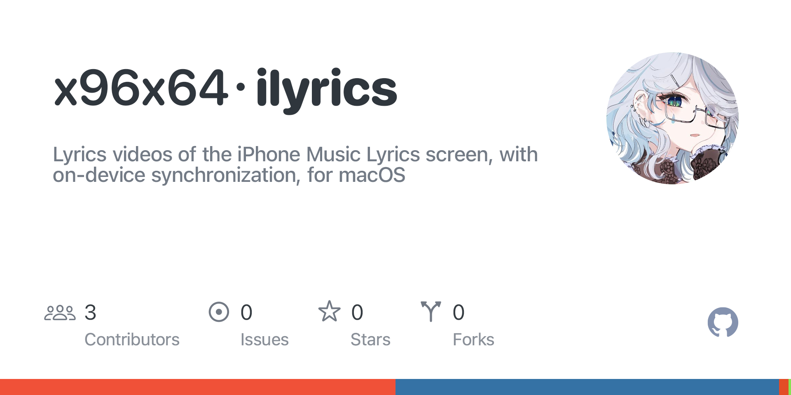

<h1>
  <picture>
    <source media="(prefers-color-scheme: dark)" srcset="assets/hello/hello-dark.svg">
    <source media="(prefers-color-scheme: light)" srcset="assets/hello/hello-light.svg">
    
  </picture>
</h1>

[](https://www.linkedin.com/in/x96x64)
[](https://www.swift.org)
[](https://www.apple.com/macos/)
[](https://developer.apple.com/documentation/coreml)
[](#how-i-work)
[](#how-i-work)
[](#what-i-believe)
[](https://github.com/x96x64/ilyrics/releases/latest)

I am a student and independent developer in Japan. I build quiet tools: software that improves your work without asking for your attention. Most of what I make lives on the command line or runs entirely on the device in front of you, and most of it is free and open-source software that anyone can read, run, and improve.

## What I Believe

Technology should be a means to a better experience, not a feature to be noticed. I am inspired by Apple's approach to Apple Intelligence and Siri AI, where intelligence quietly improves what you are already doing instead of asking you to change how you work. The best tools are the ones you hardly notice using, until you realize that your work has quietly become better.

In practice, this means that I care about the moments around the main task as much as the task itself. A command should check its inputs before it spends minutes on them, explain a problem in plain language when something goes wrong, leave nothing half-finished behind when it is interrupted, and produce the same result every time it is given the same input. None of these details is visible when everything works, and that is the point.

## How I Work

I develop together with AI coding agents. Codex and Claude take part in planning, implementation, review, and documentation, and their contributions are credited in the commit history. I decide what to build, set the constraints, and review every change before it ships; the agents make it possible for one person to keep the standards of a team, from atomic commits and continuous integration to written reports that record every measurement and every decision.

## What I Am Building

[](https://github.com/x96x64/ilyrics)

[iLyrics](https://github.com/x96x64/ilyrics) is a macOS command that renders lyrics videos reproducing the Lyrics screen of the Music app on iPhone, and synchronizes plain English lyrics to a recording entirely on your Mac. You give it a song and its lyrics; it separates the vocals, estimates where the words are sung, and renders a 1080 × 1920 video at 60 frames per second, ready for phones and social platforms. Recordings, lyrics, and videos never leave your computer.

Under the hood, HTDemucs separates the vocals and wav2vec 2.0 produces character probabilities through Core ML, which CTC forced alignment uses to estimate the timing of the supplied lyrics. Every frame is a pure function of its timestamp, drawn with Core Text and Core Graphics, so frames can be evaluated independently and rendered in parallel; this reproducibility concerns frame generation under fixed rendering conditions. In the [historical evaluation](https://github.com/x96x64/ilyrics/blob/main/docs/reports/third-preview-qualification-results.md) of commit `e0ab92a` on 80 unseen recordings with manual word timing, 95.9% of 3,005 scored lines had an accepted interval overlapping the reference interval, but three recordings fell below the per-recording placement threshold of 80%. This measures line placement rather than word-timing accuracy, and the complete locked qualification criteria were not met. The screen itself was measured against screen recordings of the Music app on iOS 27, and the known differences are documented rather than hidden.

iLyrics is written in Swift and distributed through Homebrew, npm, and PyPI.

### Homebrew

```bash
brew install x96x64/tap/ilyrics
```

### npm

```bash
npm install -g ilyrics
```

### pip

```bash
pipx install ilyrics    # or: pip install ilyrics
```

## Interests

My interests are AI agents and bots, command-line tools, free and open-source software, and audio and music files. Away from the keyboard, I listen to a lot of music from the 1960s through the 1990s, above all Michael Jackson and The Beatles. My favorite album by Michael Jackson is *HIStory: Past, Present and Future, Book I*, and my favorite of his songs is its title track, "HIStory." Every time I listen to his performance of "Dangerous" from the *HIStory World Tour*, I feel something like a powerful shock, no matter how many times I have heard it before.

## Get in Touch

You can find my work here on GitHub and my background on [LinkedIn](https://www.linkedin.com/in/x96x64). For questions or problems with iLyrics, please open an issue in the [iLyrics repository](https://github.com/x96x64/ilyrics/issues), where everyone can benefit from the answer.

## GitHub Activity

### Recent Activity

My latest public activity on GitHub, updated automatically every six hours:

<!--START_SECTION:activity-->
1. 🚀 Published release [iLyrics: v1.3.2, Lyrics Videos of the iPhone Music Lyrics Screen for macOS](https://github.com/x96x64/ilyrics/releases/tag/v1.3.2) in [x96x64/ilyrics](https://github.com/x96x64/ilyrics)
2. 💪 Opened PR [#6](https://github.com/x96x64/ilyrics/pull/6) in [x96x64/ilyrics](https://github.com/x96x64/ilyrics)
3. 🚀 Published release [iLyrics: v1.3.1, Lyrics Videos of the iPhone Music Lyrics Screen for macOS](https://github.com/x96x64/ilyrics/releases/tag/v1.3.1) in [x96x64/ilyrics](https://github.com/x96x64/ilyrics)
4. 🎉 Merged PR [#5](https://github.com/x96x64/ilyrics/pull/5) in [x96x64/ilyrics](https://github.com/x96x64/ilyrics)
5. 💪 Opened PR [#5](https://github.com/x96x64/ilyrics/pull/5) in [x96x64/ilyrics](https://github.com/x96x64/ilyrics)
<!--END_SECTION:activity-->

### GitHub Stats

These cards are generated from my public GitHub activity and refreshed automatically every six hours. The displayed figures may lag behind recent activity because the source services cache their results; if a refresh fails, the last successful cards remain available.

<a href="https://github.com/x96x64">
  <picture>
    <source media="(prefers-color-scheme: dark)" srcset="assets/github/stats-dark.svg">
    
  </picture>
</a>
<a href="https://github.com/x96x64">
  <picture>
    <source media="(prefers-color-scheme: dark)" srcset="assets/github/languages-dark.svg">
    
  </picture>
</a>

<a href="https://github.com/x96x64">
  <picture>
    <source media="(prefers-color-scheme: dark)" srcset="assets/github/streak-dark.svg">
    
  </picture>
</a>

<a href="https://github.com/x96x64">
  <picture>
    <source media="(prefers-color-scheme: dark)" srcset="assets/github/trophies-dark.svg">
    
  </picture>
</a>

<a href="https://github.com/x96x64/ilyrics">
  <picture>
    <source media="(prefers-color-scheme: dark)" srcset="assets/github/ilyrics-dark.svg">
    
  </picture>
</a>

### Contributions

Every day, a snake makes its way through my contribution graph and eats the squares in the order they were earned.

<picture>
  <source media="(prefers-color-scheme: dark)" srcset="https://raw.githubusercontent.com/x96x64/x96x64/output/github-snake-dark.svg">
  
</picture>
