<h1>
  <picture>
    <source media="(prefers-color-scheme: dark)" srcset="assets/hello/hello-dark.svg">
    <source media="(prefers-color-scheme: light)" srcset="assets/hello/hello-light.svg">
    
  </picture>
</h1>

[](https://www.linkedin.com/in/x96x64)
[](https://www.swift.org)
[](https://www.apple.com/macos/)
[](https://developer.apple.com/documentation/coreml)
[](#how-i-work)
[](#how-i-work)
[](#what-i-believe)
[](https://github.com/x96x64/ilyrics/releases/latest)
[](https://github.com/x96x64/ilibrary/releases/latest)

I am a student and independent developer in Japan. I build quiet tools: software that improves your work without asking for your attention. Most of what I make lives on the command line or runs entirely on the device in front of you, and most of it is free and open-source software that anyone can read, run, and improve.

## What I Believe

Technology should be a means to a better experience, not a feature to be noticed. I am inspired by Apple's approach to Apple Intelligence and Siri AI, where intelligence quietly improves what you are already doing instead of asking you to change how you work. The best tools are the ones you hardly notice using, until you realize that your work has quietly become better.

In practice, this means that I care about the moments around the main task as much as the task itself. A command should check its inputs before it spends minutes on them, explain a problem in plain language when something goes wrong, leave nothing half-finished behind when it is interrupted, and produce the same result every time it is given the same input. None of these details is visible when everything works, and that is the point.

## How I Work

I develop together with AI coding agents. Codex and Claude take part in planning, implementation, review, and documentation, and their contributions are credited in the commit history. I decide what to build, set the constraints, and review every change before it ships; the agents make it possible for one person to keep the standards of a team, from atomic commits and continuous integration to written reports that record every measurement and every decision.

## What I Am Building

I am currently building two command-line tools for macOS, iLyrics and iLibrary. Both are written in Swift and published as free and open-source software under the Apache License, Version 2.0. Both run entirely on the Mac, and both are designed to state what they will do before they do it.

### iLyrics

[iLyrics](https://github.com/x96x64/ilyrics) is a macOS command-line tool that creates synchronized lyrics videos reproducing the Lyrics screen of the Music app on iPhone. You give it a song and its plain English lyrics; it separates the vocals, estimates where the words are sung, and renders a 1080 × 1920 video at 60 frames per second, ready for phones and social platforms. Recordings, lyrics, and videos never leave your computer.

Under the hood, HTDemucs separates the vocals and wav2vec 2.0 produces character probabilities through Core ML, which CTC forced alignment uses to estimate the timing of the supplied lyrics. Every frame is a pure function of its timestamp, drawn with Core Text and Core Graphics, so frames can be evaluated independently and rendered in parallel; this reproducibility concerns frame generation under fixed rendering conditions. The alignment models are installed once, on first use, from their publishers' weights, which are verified against pinned digests and rebuilt as Core ML models on your Mac.

In the [historical evaluation](https://github.com/x96x64/ilyrics/blob/main/docs/reports/third-preview-qualification-results.md) of commit `e0ab92a` on 80 unseen recordings with manual word timing, 95.9% of 3,005 scored lines had an accepted interval overlapping the reference interval, but three recordings fell below the per-recording placement threshold of 80%. This measures line placement rather than word-timing accuracy, and the complete locked qualification criteria were not met. The screen itself was measured against screen recordings of the Music app on iOS 27, and the known differences are documented rather than hidden. Automatic synchronization supports English and may require manual correction; Japanese synchronization is experimental.

#### Installing iLyrics

iLyrics requires macOS 14 or later on Apple silicon. It is distributed through Homebrew, npm, and PyPI; install it through one channel only.

```bash
brew install x96x64/tap/ilyrics
npm install -g ilyrics
pipx install ilyrics    # or: pip install ilyrics
```

### iLibrary

[iLibrary](https://github.com/x96x64/ilibrary) is a macOS command-line tool that prepares music files and adds albums to a local Music library in a controlled order. It converts lossless downloads to Apple Lossless, copies iTunes Store purchases without their purchase metadata, applies metadata from a catalog file without re-encoding the audio, names files as the Music app does, and sets file dates to release dates. It then adds albums to Music one at a time and diagnoses differences between the files and the library's records. Every command that changes files or the library offers a dry run, states what it will change before changing it, and verifies its result afterwards.

The work is organized around a catalog: a JSON document that describes albums, tracks, release dates, and title rules, which can be drafted from existing tags, completed by hand or with an AI agent, validated against the files, and applied. The Swift package separates portable processing from macOS integration. `MP4Core` parses and rewrites MP4 boxes and relocates chunk offsets, so that metadata changes leave the audio data unchanged; `FLACCore` reads FLAC metadata without decoding audio; and `CatalogCore` implements the catalog format, matching, naming, ordering, title rules, and date handling. These three targets depend only on Foundation and are built and tested on Linux. Conversion through AudioToolbox, file dates, and Music automation are confined to macOS-specific targets, and no external tool is required at run time.

Version 0.1.0 is experimental. File processing is verified with synthetic inputs, and the Music operations are tested against a substitute library in the public suite. The implemented Music commands passed [validation in a separate macOS user](https://github.com/x96x64/ilibrary/blob/main/docs/reports/library-command-validation.md) on one macOS version, and 301 real-file copies passed [copy qualification](https://github.com/x96x64/ilibrary/blob/main/docs/reports/library-qualification.md). These results do not establish complete safety, compatibility with every supported macOS release, or correct behavior for every Apple Music library. The effect of iCloud Music Library matching has not been measured, and iLibrary does not claim to prevent it. Protected audio is out of scope, and iLibrary does not download audio. Following the project's own guidance, I recommend working on copies and trying the Music commands in a separate macOS user before using a personal library.

#### Installing iLibrary

iLibrary requires macOS 14 or later on Apple silicon. It is distributed through Homebrew, npm, and PyPI; install it through one channel only. The npm and PyPI names include my identifier because the plain name `ilibrary` belongs to other projects on those registries.

```bash
brew install x96x64/tap/ilibrary
npm install -g @x96_64/ilibrary
pipx install x96_64-ilibrary    # or: pip install x96_64-ilibrary
```

## Interests

My interests are AI agents and bots, command-line tools, free and open-source software, and audio and music files. Away from the keyboard, I listen to a lot of music from the 1960s through the 1990s, above all Michael Jackson and The Beatles. My favorite album by Michael Jackson is *HIStory: Past, Present and Future, Book I*, and my favorite of his songs is its title track, "HIStory." Every time I listen to his performance of "Dangerous" from the *HIStory World Tour*, I feel something like a powerful shock, no matter how many times I have heard it before.

## Get in Touch

You can find my work here on GitHub and my background on [LinkedIn](https://www.linkedin.com/in/x96x64). For questions or problems with a project, please open an issue in the matching repository, where everyone can benefit from the answer: the [iLyrics issue tracker](https://github.com/x96x64/ilyrics/issues) for iLyrics, and the [iLibrary issue tracker](https://github.com/x96x64/ilibrary/issues) for iLibrary.

## GitHub Activity

### Recent Activity

My latest public activity on GitHub, updated automatically every six hours:

<!--START_SECTION:activity-->
1. 🎉 Merged PR [#39](https://github.com/x96x64/ilibrary/pull/39) in [x96x64/ilibrary](https://github.com/x96x64/ilibrary)
2. 💪 Opened PR [#39](https://github.com/x96x64/ilibrary/pull/39) in [x96x64/ilibrary](https://github.com/x96x64/ilibrary)
3. 🎉 Merged PR [#36](https://github.com/x96x64/ilibrary/pull/36) in [x96x64/ilibrary](https://github.com/x96x64/ilibrary)
4. 🎉 Merged PR [#38](https://github.com/x96x64/ilibrary/pull/38) in [x96x64/ilibrary](https://github.com/x96x64/ilibrary)
5. 💪 Opened PR [#38](https://github.com/x96x64/ilibrary/pull/38) in [x96x64/ilibrary](https://github.com/x96x64/ilibrary)
<!--END_SECTION:activity-->

### GitHub Stats

These cards are generated from my public GitHub activity and refreshed automatically every six hours. The displayed figures may lag behind recent activity because the source services cache their results; if a refresh fails, the last successful cards remain available.

<a href="https://github.com/x96x64">
  <picture>
    <source media="(prefers-color-scheme: dark)" srcset="assets/github/stats-dark.svg">
    
  </picture>
</a>
<a href="https://github.com/x96x64">
  <picture>
    <source media="(prefers-color-scheme: dark)" srcset="assets/github/languages-dark.svg">
    
  </picture>
</a>

<a href="https://github.com/x96x64">
  <picture>
    <source media="(prefers-color-scheme: dark)" srcset="assets/github/streak-dark.svg">
    
  </picture>
</a>

<a href="https://github.com/x96x64">
  <picture>
    <source media="(prefers-color-scheme: dark)" srcset="assets/github/trophies-dark.svg">
    
  </picture>
</a>

### Contributions

Every day, a snake makes its way through my contribution graph and eats the squares in the order they were earned.

<picture>
  <source media="(prefers-color-scheme: dark)" srcset="https://raw.githubusercontent.com/x96x64/x96x64/output/github-snake-dark.svg">
  
</picture>
